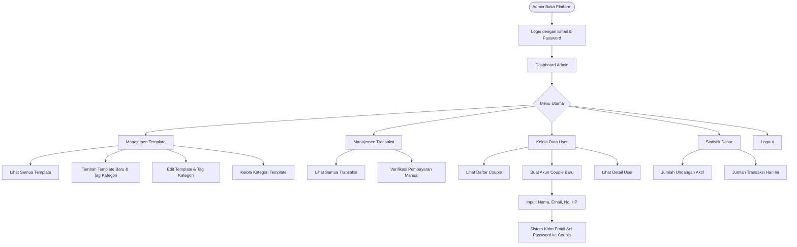
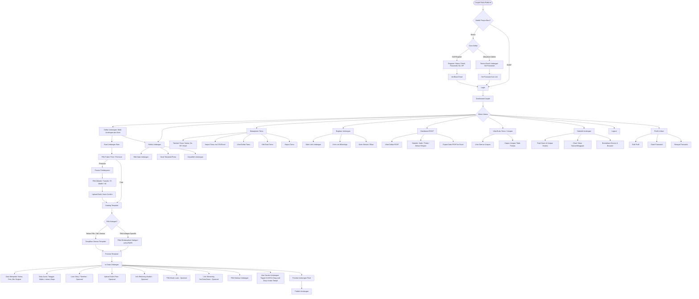
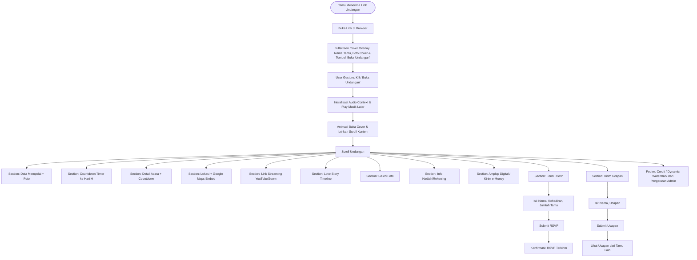

# PRD - Platform Undangan Pernikahan Online

## 1. Ringkasan Produk

**Nama Produk Bawaan:** WedInvite *(Dapat diubah secara dinamis oleh Super Admin kapan saja, misal menjadi: Undanganku, WeddingDream, dll via Admin Dashboard)*  
**Versi:** MVP 1.0  
**Tanggal:** Oktober 2026

Platform SaaS berbasis web untuk membuat, mengelola, dan membagikan undangan pernikahan digital. Seluruh identitas brand platform (nama aplikasi, tagline, logo, favicon, teks watermark footer) bersifat **fully white-labeled & configurable** langsung oleh admin dari dashboard tanpa perlu deploy ulang.

---

## 2. Latar Belakang & Masalah

| Masalah                                            | Dampak                                           |
| -------------------------------------------------- | ------------------------------------------------ |
| Undangan cetak mahal dan tidak ramah lingkungan    | Biaya tinggi, limbah kertas                      |
| Distribusi undangan fisik memakan waktu            | Tamu di luar kota/negeri sulit dijangkau         |
| Tidak ada tracking kehadiran real-time             | Perencanaan catering & tempat duduk tidak akurat |
| Tidak ada platform lokal yang lengkap & terjangkau | Pasangan harus pakai jasa desainer mahal         |

---

## 3. Tujuan Produk (MVP)

1. Pasangan dapat membuat undangan digital dalam < 15 menit
2. Tamu dapat mengakses undangan via link dan melakukan RSVP
3. Pasangan dapat melihat dashboard statistik kehadiran
4. Admin platform dapat mengelola template, user, dan transaksi
5. Platform siap dimonetisasi via paket berbayar

---

## 4. Target Pengguna & User Levels

### 4.1 User Levels

| Level             | Kode          | Deskripsi                            |
| ----------------- | ------------- | ------------------------------------ |
| Super Admin       | `SUPER_ADMIN` | Pengelola platform, full access      |
| Admin             | `ADMIN`       | Staff operasional platform           |
| Couple (Pasangan) | `COUPLE`      | Pembuat undangan (pelanggan utama)   |
| Guest (Tamu)      | `GUEST`       | Penerima undangan, tanpa perlu login |

### 4.2 Persona

**Persona 1 - Andi & Sari (Couple)**

- Pasangan usia 25-35 tahun
- Melek teknologi, aktif di sosial media
- Budget terbatas, ingin undangan elegan tanpa biaya besar
- Butuh fitur RSVP dan hitung tamu otomatis

**Persona 2 - Budi (Guest/Tamu)**

- Kerabat/teman yang menerima link undangan
- Buka undangan di HP, tidak mau ribet install app
- Ingin konfirmasi kehadiran dengan cepat

**Persona 3 - Admin Platform**

- Mengelola template, memverifikasi pembayaran
- Memonitor statistik platform

---

## 5. User Flow Diagram (Mermaid)

### 5.1 Flow - Super Admin

```mermaid
flowchart TD
    SA_START([Super Admin Buka Platform]) --> SA_LOGIN[Login dengan Email & Password]
    SA_LOGIN --> SA_DASH[Dashboard Admin]

    SA_DASH --> SA_MENU{Menu Utama}

    SA_MENU --> SA_USER[Manajemen User]
    SA_USER --> SA_USER_LIST[Lihat Daftar User]
    SA_USER --> SA_USER_CREATE[Buat Akun Couple Baru]
    SA_USER_CREATE --> SA_USER_CREATE_FORM[Input: Nama, Email, No. HP]
    SA_USER_CREATE_FORM --> SA_USER_CREATE_EMAIL[Sistem Kirim Email Set Password ke Couple]
    SA_USER --> SA_USER_EDIT[Edit/Nonaktifkan User]
    SA_USER --> SA_USER_ROLE[Ubah Role User]
    SA_USER --> SA_USER_DELETE[Hapus User]

    SA_MENU --> SA_TEMPLATE[Manajemen Template]
    SA_TEMPLATE --> SA_TPL_LIST[Lihat Semua Template]
    SA_TEMPLATE --> SA_TPL_ADD[Tambah Template Baru & Tag Kategori]
    SA_TEMPLATE --> SA_TPL_EDIT[Edit Template, Komponen & Tag Kategori]
    SA_TEMPLATE --> SA_TPL_DELETE[Hapus Template]
    SA_TEMPLATE --> SA_TPL_CATEGORY[Kelola Kategori Template Dinamis]
    SA_TPL_CATEGORY --> SA_CAT_ADD[Tambah Kategori Baru]
    SA_TPL_CATEGORY --> SA_CAT_EDIT[Edit Nama, Slug & Urutan Kategori]
    SA_TPL_CATEGORY --> SA_CAT_DELETE[Hapus Kategori]

    SA_MENU --> SA_PACKAGE[Manajemen Paket & Harga]
    SA_PACKAGE --> SA_PKG_LIST[Lihat Daftar Paket]
    SA_PACKAGE --> SA_PKG_ADD[Tambah Paket Baru: Nama, Harga, Fitur]
    SA_PACKAGE --> SA_PKG_EDIT[Edit Detail Paket]
    SA_PKG_EDIT --> SA_PKG_EDIT_NAME[Edit Nama & Deskripsi Paket]
    SA_PKG_EDIT --> SA_PKG_EDIT_PRICE[Edit Harga & Masa Aktif]
    SA_PKG_EDIT --> SA_PKG_EDIT_FEATURE[Atur Fitur per Paket]
    SA_PKG_EDIT_FEATURE --> SA_PKG_FEAT_GUEST[Max Jumlah Tamu]
    SA_PKG_EDIT_FEATURE --> SA_PKG_FEAT_PHOTO[Max Jumlah Foto Galeri]
    SA_PKG_EDIT_FEATURE --> SA_PKG_FEAT_MUSIC[Jumlah Pilihan Musik / Upload Sendiri]
    SA_PKG_EDIT_FEATURE --> SA_PKG_FEAT_TOGGLE[Toggle Fitur: Slug, Hadiah, Story, Streaming, Bahasa, Analytics, Envelope, Watermark]
    SA_PACKAGE --> SA_PKG_TOGGLE[Aktifkan/Nonaktifkan Paket]
    SA_PACKAGE --> SA_PKG_DELETE[Hapus Paket]
    SA_PACKAGE --> SA_PKG_ORDER[Atur Urutan Tampil di Halaman Pricing]

    SA_MENU --> SA_TRX[Manajemen Transaksi]
    SA_TRX --> SA_TRX_LIST[Lihat Semua Transaksi]
    SA_TRX --> SA_TRX_VERIFY[Verifikasi Pembayaran Manual]
    SA_TRX --> SA_TRX_REFUND[Proses Refund]

    SA_MENU --> SA_STATS[Statistik & Laporan]
    SA_STATS --> SA_STATS_REVENUE[Laporan Pendapatan]
    SA_STATS --> SA_STATS_USER[Statistik User Baru]
    SA_STATS --> SA_STATS_INVITATION[Statistik Undangan Dibuat]

    SA_MENU --> SA_MASTER[Manajemen Master Data & Konten Dinamis]
    SA_MASTER --> SA_M_PAY[Master Bank & E-Wallet Providers]
    SA_MASTER --> SA_M_EVENT[Master Jenis Acara / Adat]
    SA_MASTER --> SA_M_WA[Master Template Pesan WhatsApp]
    SA_MASTER --> SA_M_LANG[Kamus Bahasa & Teks UI Dinamis]
    SA_MASTER --> SA_M_SEC[Katalog Section & Registry Template]

    SA_MENU --> SA_SETTINGS[Pengaturan Platform Dinamis]
    SA_SETTINGS --> SA_SET_CONFIG[Global App Settings Key-Value]
    SA_SETTINGS --> SA_SET_FLAGS[Feature Flags & Kill-Switches]
    SA_SETTINGS --> SA_SET_PAYMENT[Konfigurasi Payment Gateway Midtrans]
    SA_SETTINGS --> SA_SET_EMAIL[Konfigurasi Email Resend/SMTP]
    SA_SETTINGS --> SA_SET_STORAGE[Batas Upload Media & Retensi]

    SA_MENU --> SA_LOGOUT[Logout]
```



### 5.2 Flow - Admin



### 5.3 Flow - Couple (Pasangan)



### 5.4 Flow - Guest (Tamu Undangan)



---

## 6. Fitur MVP - Detail

### 6.1 Modul Autentikasi

| ID      | Fitur                  | Deskripsi                                                  | User Level          | Prioritas |
| ------- | ---------------------- | ---------------------------------------------------------- | ------------------- | --------- |
| AUTH-01 | Register Couple (Self) | Daftar akun sendiri dengan nama, email, password, no. HP   | Couple              | HIGH      |
| AUTH-02 | Login                  | Login dengan email & password                              | All (kecuali Guest) | HIGH      |
| AUTH-03 | Verifikasi Email       | Kirim link verifikasi ke email saat self-register          | Couple              | HIGH      |
| AUTH-04 | Lupa Password          | Reset password via link email                              | All (kecuali Guest) | HIGH      |
| AUTH-05 | Logout                 | Keluar dari sesi aktif                                     | All (kecuali Guest) | HIGH      |
| AUTH-06 | Admin Buat Akun Couple | Admin membuat akun couple, sistem kirim email set password | Admin, Super Admin  | HIGH      |

**Detail Task AUTH-01 (Register Couple - Self):**

- Route: `POST /register` (Laravel Breeze)
- Input: `name`, `email`, `password`, `password_confirmation`, `phone`
- Validasi: `StoreUserRequest` (email unik, password min 8 karakter, phone format Indonesia E.164)
- Output: User record dengan `is_verified = false` + kirim email verifikasi via Resend
- Redirect: Inertia view "Cek email untuk verifikasi"
- Couple harus klik link verifikasi sebelum dapat mengakses dashboard

**Detail Task AUTH-06 (Admin Buat Akun Couple):**

- Route: `POST /admin/users` (Filament UserResource / Admin Panel)
- Input: `name`, `email`, `phone`
- Hanya dapat diakses oleh role `ADMIN` atau `SUPER_ADMIN`
- Password TIDAK diinput admin — sistem men-dispatch `SendSetPasswordEmailJob`
- User dibuat dengan `is_verified = true` (pre-verified karena dibuat oleh admin)
- Sistem kirim email ke couple berisi:
  - Pesan selamat datang
  - Link set password bertoken (berlaku 24 jam): `/set-password/{token}`
  - Instruksi login setelah set password
- Jika couple tidak set password dalam 24 jam, admin dapat menekan tombol resend invite
- Validasi: email unik, phone format E.164 (`628xxxxxxxxxx`)

**Detail Task AUTH-02 (Login):**

- Route: `POST /login` (Laravel Breeze Session Auth)
- Input: `email`, `password`, `remember` (boolean)
- Output: Authenticated Web Session Cookie + secure CSRF token
- Redirect otomatis berdasarkan role:
  - Super Admin & Admin -> `/admin` (Filament Dashboard)
  - Couple -> `/dashboard` (Inertia Couple Dashboard)

---

### 6.2 Modul Dashboard Couple

| ID      | Fitur          | Deskripsi                                            | Prioritas |
| ------- | -------------- | ---------------------------------------------------- | --------- |
| DASH-01 | Overview       | Ringkasan: jumlah tamu, RSVP masuk, status undangan  | HIGH      |
| DASH-02 | Quick Actions  | Tombol cepat: Buat Undangan, Kelola Tamu, Lihat RSVP | HIGH      |
| DASH-03 | Statistik RSVP | Chart: Hadir vs Tidak Hadir vs Belum Respon          | HIGH      |
| DASH-04 | Ucapan Terbaru | 5 ucapan terbaru dari tamu                           | MEDIUM    |
| DASH-05 | Statistik Views | Total views & unique visitors undangan              | HIGH      |
| DASH-06 | Rekap Amplop Digital | Total amplop masuk & jumlah nominal              | MEDIUM    |

---

### 6.3 Modul Undangan

| ID     | Fitur               | Deskripsi                                                                             | Prioritas |
| ------ | ------------------- | ------------------------------------------------------------------------------------- | --------- |
| INV-01 | Pilih Template      | Browse & preview template dari katalog                                                | HIGH      |
| INV-02 | Isi Data Mempelai   | Form: nama pria, nama wanita, foto masing-masing, nama orang tua                      | HIGH      |
| INV-03 | Isi Data Acara      | Form: nama acara (Akad/Resepsi), tanggal, waktu mulai-selesai, alamat, koordinat maps | HIGH      |
| INV-04 | Multiple Event      | Support > 1 acara (misal: Akad Nikah + Resepsi)                                       | HIGH      |
| INV-05 | Love Story          | Timeline cerita perjalanan cinta (tanggal + deskripsi)                                | MEDIUM    |
| INV-06 | Galeri Foto         | Upload hingga 10 foto (max 2MB/foto)                                                  | MEDIUM    |
| INV-07 | Musik Latar         | Pilih dari library musik atau upload sendiri                                          | MEDIUM    |
| INV-08 | Info Multi-Rekening | Input satu atau lebih rekening bank/e-wallet untuk hadiah digital                      | MEDIUM    |
| INV-09 | Preview             | Lihat tampilan undangan sebelum publish                                               | HIGH      |
| INV-10 | Publish / Unpublish | Aktifkan/nonaktifkan undangan                                                         | HIGH      |
| INV-11 | Custom Slug         | URL custom: `wedinvite.com/andi-sari`                                                 | HIGH      |
| INV-12 | Edit Undangan       | Edit semua data setelah publish                                                       | HIGH      |
| INV-13 | Countdown Timer     | Hitung mundur otomatis ke tanggal acara terdekat, dihitung client-side                | HIGH      |
| INV-14 | Streaming Link      | Input link YouTube/Zoom untuk tamu yang hadir virtual (undangan hybrid)                | MEDIUM    |
| INV-15 | Multi-bahasa        | Couple pilih bahasa undangan: Bahasa Indonesia atau English                            | MEDIUM    |
| INV-16 | Digital Envelope    | Tamu kirim amplop digital via QRIS / transfer, dengan status verifikasi couple        | MEDIUM    |
| INV-17 | Perpanjang Masa Aktif| Pengelolaan perpanjangan durasi undangan jika melewati masa aktif (expired)          | MEDIUM    |

**Detail Task INV-01 (Pilih Template):**

- Endpoint: `GET /api/templates?category_id=`
- Filter Kategori: Tab filter dinamis ("Semua Template", lalu diikuti kategori yang dibuat admin seperti "Islami", "Minimalis", "Rustic", dll)
- **Default "Semua Template" (Select All):** Jika kategori belum dipilih secara spesifik atau user memilih tab "Semua", sistem menampilkan seluruh template aktif secara penuh tanpa filter
- Tagging & Relasi: Setiap template terhubung ke satu atau lebih kategori (`template_category_tags` / pivot table) yang dapat diatur admin
- Setiap template card menampilkan: thumbnail, nama template, badge kategori, dan tombol preview
- **Semua template dapat diakses bebas** oleh semua user/paket tanpa batasan free/premium
- Klik template -> preview full-page
- Tombol "Gunakan Template" -> simpan pilihan ke draft undangan
- Template dapat diganti sewaktu-waktu oleh couple/admin tanpa kehilangan data yang sudah diisi

**Arsitektur Dynamic Template Rendering:**
- Template bersifat decoupled dari data undangan (*headless content architecture*)
- Seluruh data undangan (mempelai, acara, galeri, story, ucapan, rsvp, countdown, stream, amplop) dikirim via standard props contract (`InvitationPageProps`)
- Setiap template mengimplementasikan layout & styling unik, tetapi merender data dari contract interface yang seragam
- Ketika couple/admin mengganti template (misal: dari Modern Rustic ke Islamic Elegant), hanya ID/komponen template renderer yang berubah, seluruh konten & fungsionalitas tamu tetap utuh dan ter-render otomatis tanpa perlu input ulang data

**Detail Task INV-03 (Data Acara):**

- Route: `POST /invitations/{id}/events`
- Input per event:
  ```json
  {
    "event_name": "Akad Nikah",
    "date": "2026-12-20",
    "time_start": "08:00",
    "time_end": "10:00",
    "venue_name": "Masjid Al-Ikhlas",
    "address": "Jl. Merdeka No. 10, Jakarta",
    "latitude": -6.2088,
    "longitude": 106.8456
  }
  ```
- Validasi: `StoreEventRequest` (tanggal harus di masa depan, waktu mulai < waktu selesai)
- Google Maps embed otomatis dari koordinat

**Detail Task INV-11 (Custom Slug & Reserved Route Protection):**

- Route: `PATCH /invitations/{id}/slug`
- Input: `slug` (alphanumeric + dash, 3-50 karakter, lowercase)
- **Reserved Slugs Blacklist:** Laravel FormRequest Rule menolak pembuatan slug yang berbenturan dengan sistem rute internal:
  `["admin", "api", "login", "register", "dashboard", "pricing", "checkout", "verify-email", "set-password", "forgot-password", "reset-password", "invitation", "terms", "privacy", "templates", "upload", "static", "public", "assets", "favicon", "robots"]`
- Validasi: slug harus unik di seluruh database, tidak boleh diawali/diakhiri strip (`-`)
- URL final: `https://wedinvite.com/{slug}`

**Detail Task INV-13 (Countdown Timer):**
- Komponen client-side yang menghitung mundur ke tanggal event terdekat
- Menampilkan: Hari, Jam, Menit, Detik
- Otomatis mengambil tanggal dari event pertama (Akad/Resepsi)
- Setelah event berlalu, tampilkan pesan "Acara telah berlangsung"

**Detail Task INV-14 (Streaming Link):**
- Route: `PATCH /invitations/{id}`
- Input: `streaming_url` (URL YouTube Live / Zoom meeting)
- Validasi: harus URL valid (youtube.com, youtu.be, zoom.us)
- Di halaman undangan: tampilkan embed video atau tombol "Gabung Virtual"
- Hanya muncul jika couple mengisi link streaming

**Detail Task INV-15 (Multi-bahasa):**
- Route: `PATCH /invitations/{id}`
- Input: `language` (enum: `id`, `en`)
- Default: `id` (Bahasa Indonesia)
- Semua teks statis di halaman undangan (label section, tombol, placeholder) disesuaikan berdasarkan pilihan bahasa
- Data dinamis (nama, alamat, ucapan) tetap sesuai input user
- Implementasi: kamus dinamis dari database `app_settings` / file lokal `lang/`

**Detail Task INV-08 (Info Multi-Rekening Hadiah):**
- Route: `POST /invitations/{id}/bank-accounts`, `DELETE /invitations/{id}/bank-accounts/{accountId}`
- Input: `provider_id` (dari master provider), `bank_or_wallet_name`, `account_number`, `account_holder`, `qr_code_url` (opsional)
- Mendukung banyak rekening (1:N) sehingga mempelai pria, wanita, maupun orang tua dapat menyertakan rekening masing-masing
- Di halaman undangan: ditampilkan dalam bentuk accordion/kartu rekening dengan tombol "Salin Nomor Rekening"

**Detail Task INV-16 (Digital Envelope & Rekonsiliasi Status):**
- Tamu bisa mengirim amplop digital (hadiah uang) langsung dari halaman undangan
- Metode pembayaran:
  1. **Transfer Manual / E-Wallet:** Tamu transfer ke rekening couple, lalu mengunggah bukti transfer (`proof_image_url`) atau konfirmasi kirim -> status: `UNVERIFIED_CLAIM`
  2. **Payment Gateway Otomatis (Midtrans):** Tamu membayar via VA/QRIS gateway platform -> status langsung otomatis: `CONFIRMED`
- Route tamu: `POST /{slug}/envelope`
- Route couple: `PATCH /invitations/{id}/envelope/{envelopeId}/verify` (Couple dapat mengubah status klaim manual menjadi `CONFIRMED` atau `REJECTED`)
- Dashboard rekap amplop menampilkan pemisahan jelas antara total dana terverifikasi (*Confirmed*) dan klaim belum terkonfirmasi (*Unverified*)

**Detail Task INV-17 (Handling Masa Aktif & Expiry Grace Period):**
- Sistem melakukan cron job harian via Laravel Scheduler (`schedule:run`) untuk memeriksa `expires_at` pada tabel `invitations`
- Jika `now() > expires_at`:
  - `is_expired` diubah menjadi `true`
  - Jika link publik `/{slug}` dibuka, pengunjung disajikan halaman ramah: *"Masa aktif undangan ini telah berakhir. Terima kasih atas doa dan kehadirannya."* (bukan error 404)
  - Di dashboard couple, muncul banner notifikasi dan tombol "Perpanjang Masa Aktif" yang mengarahkan ke halaman perpanjangan paket (`/checkout/{package}?renew_for={invitation_id}`)

---

### 6.11 Modul Analytics

| ID      | Fitur                  | Deskripsi                                                     | Prioritas |
|---------|------------------------|---------------------------------------------------------------|-----------|
| ANA-01  | Tracking Views         | Catat setiap kunjungan ke halaman undangan                    | HIGH      |
| ANA-02  | Unique Visitors        | Hitung visitor unik berdasarkan IP / fingerprint              | HIGH      |
| ANA-03  | Dashboard Analytics    | Chart views harian/mingguan di dashboard couple               | MEDIUM    |
| ANA-04  | Device & Browser Info  | Breakdown pengunjung berdasarkan device (mobile/desktop) dan browser | MEDIUM |

**Detail Task ANA-01 (Tracking Views):**
- Route: `POST /api/invitations/{slug}/track` (dipanggil otomatis saat halaman undangan dibuka)
- Data yang dicatat: `invitation_id`, `ip_address`, `user_agent`, `referrer`, `timestamp`
- Tidak memerlukan login
- Anti-duplicate: 1 IP hanya dihitung 1x per 30 menit

**Detail Task ANA-03 (Dashboard Analytics):**
- Route: `GET /invitations/{id}/analytics`
- Response: Inertia props `{ total_views, unique_visitors, views_today, daily_chart[], device_breakdown{} }`
- Tampilkan di dashboard couple sebagai card statistik + line chart

---

### 6.4 Modul Manajemen Tamu

| ID       | Fitur                  | Deskripsi                                                               | Prioritas |
| -------- | ---------------------- | ----------------------------------------------------------------------- | --------- |
| GUEST-01 | Tambah Tamu Manual     | Input: nama, no. HP, email (opsional), kategori (keluarga/teman/kantor) | HIGH      |
| GUEST-02 | Import Tamu            | Upload file CSV/Excel dengan kolom: nama, phone, email, kategori        | HIGH      |
| GUEST-03 | Daftar Tamu            | Tabel tamu dengan filter & search                                       | HIGH      |
| GUEST-04 | Edit Tamu              | Edit data individual tamu                                               | HIGH      |
| GUEST-05 | Hapus Tamu             | Hapus tamu (soft delete)                                                | HIGH      |
| GUEST-06 | Generate Link Personal | Setiap tamu punya link unik: `wedinvite.com/andi-sari?to=Budi`          | HIGH      |

**Detail Task GUEST-01 & GUEST-02 (Normalisasi Nomor HP & Import):**

- Route: `POST /invitations/{id}/guests` & `POST /invitations/{id}/guests/import`
- **Normalisasi E.164 Otomatis:** Semua nomor HP yang diinput/diimpor disanitasi otomatis di `StoreGuestRequest` ke format internasional tanpa simbol (contoh: `0812-3456-7890`, `+62 812 3456`, atau `08123456` diubah menjadi `6281234567890`) agar kompatibel 100% dengan link WhatsApp `https://wa.me/62812...`.
- Format kolom import: `nama | phone | email | kategori`
- Sediakan template download CSV/Excel
- Validasi: skip row duplikat (by phone), tampilkan summary import (berhasil/gagal/skip)
- Diproses via queue `ProcessGuestImportJob` untuk mencegah timeout pada import besar

**Detail Task GUEST-06 (Personal Link & ResponseCache-Compatible Resolution):**

- Format link personal: `https://wedinvite.com/{slug}?to={guest_token}` (menggunakan token NanoID acak 12 karakter aman)
- **Arsitektur Pemisahan ResponseCache vs Token:**
  - Halaman `/{slug}` disajikan oleh `InvitationViewController@show` melalui Inertia.js dan di-cache penuh oleh `spatie/laravel-responsecache` di level server/memory.
  - Untuk menjaga agar cache halaman HTML publik tetap statis dan dapat digunakan kembali untuk ribuan tamu sekaligus tanpa membebani database, penyisipan nama tamu dilakukan di sisi klien pada komponen cover overlay via request ringan: `GET /api/guests/resolve?token={guest_token}`.
  - Jika token valid, nama tamu ditampilkan: *"Kepada Yth. Bapak/Ibu/Saudara/i [Nama Tamu]"*.
  - Jika token tidak ada atau tidak valid, nama tamu default: *"Tamu Undangan"*.

**Detail Task RSVP-01 (Form RSVP Multi-Acara, Proteksi Bot & Forwarding Detection):**

- Tidak perlu login
- **Deteksi Link Terusan (Forwarding Protection):**
  - Jika tamu membuka link yang membawa token milik orang lain (misal di-forward oleh kerabat), form RSVP menampilkan: *"Mengisi konfirmasi kehadiran atas nama: [Nama Tamu]? Bukan Anda? [Klik di sini untuk mengisi atas nama sendiri]"*.
  - Opsi *"Isi atas nama sendiri"* me-reset `guest_id = null` sehingga tamu tambahan tetap bisa RSVP tanpa menimpa data kehadiran pemegang link asli.
- Form field:
  - Nama (pre-filled jika token terverifikasi, atau editable jika mode mandiri)
  - Konfirmasi kehadiran umum: Hadir / Tidak Hadir
  - **Pilihan Kehadiran Per Acara (Multi-Event Selection):**
    - Tamu dapat memilih kehadiran terpisah untuk setiap acara yang ada pada undangan (contoh: Akad Nikah -> Hadir/Tidak, Resepsi -> Hadir/Tidak)
    - Tersimpan relasional ke tabel pivot `rsvp_events`
  - Jumlah tamu yang dibawa (number, max sesuai setting couple)
  - Catatan / Ucapan selamat (textarea, opsional)
- Route: `POST /{slug}/rsvp`
- **Proteksi Bot & Spam Tingkat Lanjut (Turnstile + Honeypot):**
  - Integrasi Cloudflare Turnstile (verifikasi non-intrusif di background via Laravel HTTP Client)
  - Hidden honeypot field (jika terisi oleh bot, request langsung di-reject)
- Setelah submit: kembalikan respons sukses, kunci form di browser untuk mencegah double-submission

---

### 6.6 Modul Ucapan / Buku Tamu

| ID      | Fitur                    | Deskripsi                                      | Prioritas |
| ------- | ------------------------ | ---------------------------------------------- | --------- |
| WISH-01 | Kirim Ucapan (Guest)     | Form: nama, ucapan (max 500 karakter) + Cloudflare Turnstile proteksi | HIGH      |
| WISH-02 | Lihat Ucapan (Guest)     | Daftar ucapan dari tamu lain (infinite scroll) | HIGH      |
| WISH-03 | Moderasi Ucapan (Couple) | Lihat semua ucapan, hapus ucapan tidak pantas  | MEDIUM    |

---

### 6.7 Modul Berbagi Undangan

| ID       | Fitur                 | Deskripsi                                                | Prioritas |
| -------- | --------------------- | -------------------------------------------------------- | --------- |
| SHARE-01 | Salin Link            | Copy link undangan ke clipboard                          | HIGH      |
| SHARE-02 | Kirim via WhatsApp    | Buka WhatsApp dengan pesan template + link personal      | HIGH      |
| SHARE-03 | Kirim Massal WhatsApp | Blast pesan ke semua tamu dari daftar tamu (via WA link) | MEDIUM    |
| SHARE-04 | Share ke Sosial Media | Tombol share ke Instagram Story, Facebook, Twitter       | LOW       |

**Detail Task SHARE-02 (Kirim via WhatsApp):**

- Generate pesan template:

  ```
  Assalamualaikum {nama_tamu},

  Dengan memohon rahmat Allah SWT, kami mengundang Bapak/Ibu/Saudara/i
  untuk menghadiri acara pernikahan kami:

  {nama_pria} & {nama_wanita}

  Silakan buka undangan di:
  {link_personal}

  Merupakan suatu kehormatan bagi kami apabila
  Bapak/Ibu/Saudara/i berkenan hadir.

  Terima kasih.
  ```

- Buka `https://wa.me/{phone}?text={encoded_message}`
- Couple bisa edit template pesan

**Detail Task SHARE-03 (Kirim Massal WhatsApp via Antrean / Queue):**
- Mengingat browser modern memblokir pembukaan tab ganda (*browser popup blocker*), fitur kirim massal pada MVP diimplementasikan dengan **Antrean Terpandu (Guided Queue Mode)**:
  - Dashboard menampilkan daftar tamu yang belum dikirim (`is_sent = false`)
  - Tombol "Kirim Berikutnya" yang membuka WhatsApp Web / App per tamu dengan 1 klik user gesture
  - Setelah link WA terbuka, status otomatis berubah menjadi `is_sent = true` dan daftar bergeser ke tamu selanjutnya
  - Progres pengiriman ditampilkan (contoh: 45 / 150 tamu terkirim)
  - Pasangan juga dapat mengekspor rekap URL undangan per tamu ke Excel jika ingin menggunakan bot WhatsApp eksternal mandiri

---

### 6.8 Modul Template (Admin & System)

Seluruh template undangan **dapat diakses secara gratis oleh semua pengguna dan admin**. Tidak ada pembedaan antara template free atau premium. 

**Pengaturan Kategori Dinamis & Tagging:**
- Admin memiliki kendali penuh untuk membuat, mengubah, mengurutkan, dan menghapus kategori template (`template_categories`).
- Template dan kategori menggunakan relasi **Many-to-Many / Tagging** (`template_category_tags`), sehingga 1 template dapat memiliki beberapa tag kategori (misal: "Minimalis" + "Islami").
- Di antarmuka katalog (baik bagi Couple saat memilih tema maupun Admin saat mengelola):
  - Disediakan opsi default **"Semua Template" (Select All)**. Jika kategori belum dipilih secara spesifik, sistem otomatis menampilkan **seluruh template** tanpa batasan.
  - User dapat memfilter berdasarkan kategori spesifik dengan mengklik tab kategori.

**Dynamic Rendering Contract:**
Pengguna dapat berganti template kapan saja, dan sistem memastikan seluruh komponen/detail (mempelai, acara, maps, story, galeri, musik, amplop, rsvp, ucapan, timer, live streaming) ter-render secara dinamis dan konsisten di setiap template tanpa merusak data yang telah dimasukkan.

| ID     | Fitur                   | Deskripsi                                                                    | Prioritas |
| ------ | ----------------------- | ---------------------------------------------------------------------------- | --------- |
| TPL-01 | CRUD Template           | Tambah, edit, nonaktifkan, dan hapus template serta kelola tag kategorinya   | HIGH      |
| TPL-02 | Manajemen Kategori      | CRUD kategori template dinamis (nama, slug, icon, urutan tampil)             | HIGH      |
| TPL-03 | Tagging Template        | Hubungkan (tag/untag) satu atau lebih kategori ke suatu template             | HIGH      |
| TPL-04 | Filter & Select All     | Filter template by category dengan fallback default menampilkan semua template| HIGH      |
| TPL-05 | Preview & Switcher      | Preview real-time dengan dummy data atau data asli undangan                  | HIGH      |
| TPL-06 | Upload Thumbnail        | Upload gambar preview / mockup template                                      | HIGH      |
| TPL-07 | Dynamic Content Contract| Standard contract rendering agar data tidak rusak saat switch tema           | HIGH      |

---

### 6.9 Modul Paket & Pembayaran

Semua paket harga bersifat **dinamis** — dikelola sepenuhnya oleh Super Admin melalui admin dashboard. Tidak ada fitur yang di-hardcode ke paket tertentu. Admin bebas membuat paket baru, mengubah nama paket (misal: Basic, Pro, Ultimate atau Free, Silver, Gold), menentukan harga, serta mencentang/menonaktifkan fitur apa saja yang didapat oleh masing-masing paket.

| ID     | Fitur                   | Deskripsi                                                                    | User Level         | Prioritas |
| ------ | ----------------------- | ---------------------------------------------------------------------------- | ------------------ | --------- |
| PAY-01 | Daftar Paket (Public)   | Halaman pricing dinamis, menampilkan paket aktif sesuai konfigurasi admin    | All                | HIGH      |
| PAY-02 | Checkout                | Pilih paket -> isi data -> pilih metode bayar                                | Couple             | HIGH      |
| PAY-03 | Payment Gateway         | Integrasi Midtrans (otomatis verifikasi via webhook)                         | Couple             | HIGH      |
| PAY-04 | Verifikasi Manual       | Admin verifikasi pembayaran transfer manual                                  | Admin, Super Admin | MEDIUM    |
| PAY-05 | Riwayat Transaksi       | Couple lihat history pembayaran & status paket aktif                         | Couple             | MEDIUM    |
| PAY-06 | Kelola Paket (Admin)    | CRUD paket: nama, harga, masa aktif, urutan tampil                           | Super Admin        | HIGH      |
| PAY-07 | Atur Fitur Paket (Admin)| Checklist & batasan fitur per paket (tamu, foto, musik, toggle fitur)        | Super Admin        | HIGH      |

**Detail Task PAY-03 (Idempotent Webhook Handler Midtrans):**
- Endpoint: `POST /api/transactions/webhook`
- Midtrans mengirim status: `settlement`, `capture`, `pending`, `deny`, `expire`, `cancel`
- **Idempotency Protection:**
  - Endpoint menggunakan database transaction lock (`DB::transaction` dengan `lockForUpdate()`)
  - Sebelum update, sistem mengecek `transactions.payment_status` saat ini.
  - Jika transaksi sudah berstatus `PAID` / `SETTLEMENT`, sistem langsung mengembalikan `HTTP 200 OK` (skip processing) untuk mencegah penambahan ganda pada masa aktif `expires_at` saat Midtrans mengirim retry webhook.
  - Signature verification menggunakan hashing `hash('sha512', $orderId . $statusCode . $grossAmount . $serverKey)` untuk menjamin integritas webhook.

**Detail Task PAY-06 & PAY-07 (Pengaturan Paket oleh Admin):**

Admin dapat mengatur setiap paket dengan parameter berikut:

1. **Informasi Dasar:**
   - Nama Paket (misal: "Gratis", "Silver", "Gold", atau nama kustom lain)
   - Deskripsi singkat / tagline
   - Harga (Rp 0 untuk paket gratis, atau nominal lain)
   - Masa Aktif (dalam hari, misal: 90 hari, 180 hari, 365 hari)
   - Status: Aktif / Nonaktif
   - Badge / Label (opsional, misal: "Paling Populer", "Best Value")
   - Urutan tampil di halaman pricing

2. **Pengaturan Batasan Kuota (Numeric Limits):**
   - Max Jumlah Tamu (angka, atau kosongkan untuk unlimited)
   - Max Foto Galeri (angka)
   - Max Lagu Musik Latar (angka, atau izinkan upload sendiri)

3. **Pengaturan Akses Fitur (Feature Toggles - On/Off per paket):**
   - Custom Slug (`wedinvite.com/nama-pasangan`)
   - Info Rekening Hadiah
   - Love Story / Timeline
   - Countdown Timer
   - Link Streaming (YouTube/Zoom)
   - Multi-bahasa (ID / EN)
   - Analytics (Lengkap vs Hanya total views)
   - Amplop Digital (QRIS / e-Money)
   - Hapus Watermark Brand Platform (misal: "Powered by [Nama Aplikasi]")
   - Import Tamu via Excel/CSV
   - Kirim WhatsApp Blast

**Contoh Konfigurasi Default Paket (Bisa Diubah Kapan Saja oleh Admin):**

| Pengaturan / Fitur | Paket 1 (Contoh: Free) | Paket 2 (Contoh: Silver) | Paket 3 (Contoh: Gold) |
| ------------------- | ---------------------- | ------------------------ | ---------------------- |
| Harga | Rp 0 | Rp 99.000 | Rp 199.000 |
| Masa Aktif | 90 hari | 180 hari | 365 hari |
| Akses Template | Semua Template | Semua Template | Semua Template |
| Max Tamu | 100 (bisa diubah) | 500 (bisa diubah) | Unlimited |
| Max Foto Galeri | 3 (bisa diubah) | 10 (bisa diubah) | 20 (bisa diubah) |
| Musik Latar | 1 lagu bawaan | 5 lagu bawaan | Upload sendiri |
| Custom Slug | OFF | ON | ON |
| RSVP & Buku Tamu | ON | ON | ON |
| Info Hadiah | OFF | ON | ON |
| Love Story | OFF | ON | ON |
| Countdown Timer | ON | ON | ON |
| Streaming Link | OFF | ON | ON |
| Multi-bahasa | OFF | ON | ON |
| Analytics | Basic (views saja) | Lengkap | Lengkap |
| Amplop Digital | OFF | ON | ON |
| Hapus Watermark | OFF | OFF | ON |
| Import Tamu Excel | OFF | ON | ON |
| WhatsApp Blast | OFF | ON | ON |

> **Catatan Arsitektur:** Setiap kali user membuat atau mengedit undangan, sistem mengecek batasan fitur berdasarkan paket yang aktif pada undangan tersebut (`packages` record via `invitation.package_id`). Jika admin mengubah konfigurasi paket, perubahan langsung berlaku untuk undangan yang terkait.

---

### 6.10 Modul Admin Dashboard & Konfigurasi Dinamis

| ID      | Fitur               | Deskripsi                                                     | User Level         | Prioritas |
| ------- | ------------------- | ------------------------------------------------------------- | ------------------ | --------- |
| ADM-01  | Dashboard Overview  | Total user, undangan, pendapatan                              | Admin, Super Admin | HIGH      |
| ADM-02  | Manajemen User      | CRUD user (termasuk buat akun couple), ubah role, nonaktifkan | Super Admin        | HIGH      |
| ADM-02a | Buat Akun Couple    | Admin buat akun couple, sistem kirim email set password       | Admin, Super Admin | HIGH      |
| ADM-03  | Manajemen Transaksi | Lihat & verifikasi transaksi                                  | Admin, Super Admin | HIGH      |
| ADM-04  | Laporan Pendapatan  | Chart pendapatan harian/bulanan                               | Super Admin        | MEDIUM    |
| ADM-05  | Global App Settings | Mesin konfigurasi Key-Value platform (kuota, limit, timeout) | Super Admin        | HIGH      |
| ADM-06  | Feature Flags Engine| Toggle sakelar on/off fitur sistem global (kill-switches)     | Super Admin        | HIGH      |
| ADM-07  | Master Providers    | CRUD provider bank & e-wallet untuk hadiah digital            | Admin, Super Admin | HIGH      |
| ADM-08  | Master Event Types  | CRUD jenis acara/prosesi adat (Akad, Resepsi, Siraman, dll)   | Admin, Super Admin | HIGH      |
| ADM-09  | Template Pesan WA   | CRUD preset template pesan WhatsApp dengan token dinamis      | Admin, Super Admin | HIGH      |
| ADM-10  | Dynamic UI Strings  | Pengelolaan kamus terjemahan & teks UI dinamis                | Super Admin        | MEDIUM    |

---

### 6.12 Detail Mesin Konfigurasi Dinamis (Senior Engineer Architecture)

#### 1. Global App Settings Engine (`app_settings`)
- Endpoint: `GET /api/admin/settings`, `PATCH /api/admin/settings`
- Admin mengontrol parameter operasional sistem secara real-time tanpa *redeploy*:
  - **Identitas & Branding Platform (Dynamic White-Label):**
    - `general.app_name` (nama aplikasi, misal: "Undanganku" / "WeddingDream", default: "WedInvite")
    - `general.app_tagline` (tagline platform, misal: "Platform Undangan Digital Elegan")
    - `general.app_logo_url` (URL logo brand di navbar dan email)
    - `general.app_favicon_url` (URL favicon browser)
    - `general.watermark_text` (teks watermark footer, misal: "Powered by WeddingDream")
    - `general.watermark_link` (link tujuan klik watermark)
  - **Limit & Kapasitas:**
    - `upload.max_photo_size_mb` (default: 2, dikompresi di browser ke < 800KB)
    - `upload.max_music_size_mb` (default: 5)
    - `guests.max_import_rows` (default: 500)
  - **Keamanan & Durasi:**
    - `security.rate_limit_rsvp_per_ip_minutes` (default: 15)
    - `security.turnstile_enabled` (default: true)
    - `invitation.default_active_days` (default: 90)
    - `system.maintenance_mode` (default: false)

#### 2. Feature Flagging Engine (`feature_flags`)
- Endpoint: `GET /api/admin/feature-flags`, `PATCH /api/admin/feature-flags/:key`
- Memungkinkan admin mengaktifkan/menonaktifkan fitur secara global (*circuit breaker / kill-switch*):
  - `GATEWAY_PAYMENT_ENABLED` (jika Midtrans error, langsung fallback ke transfer manual)
  - `DIGITAL_ENVELOPE_ENABLED`
  - `STREAMING_LINK_ENABLED`
  - `ANALYTICS_ENABLED`

#### 3. Dynamic Section Registry per Undangan (`invitation_sections`)
- Endpoint: `GET /api/invitations/:id/sections`, `PUT /api/invitations/:id/sections`
- Pasangan atau admin dapat mengatur tata letak undangan:
  - Toggle On/Off section: Mempelai, Countdown, Acara, Lokasi/Maps, Love Story, Galeri, Hadiah/Rekening, Amplop Digital, RSVP, Ucapan, Streaming.
  - Urutkan posisi section (*drag-and-drop sort_order*).
  - Ubah judul kustom per section (contoh: "Kisah Cinta" -> "Our Journey").

#### 4. Master Payment Providers & Bank Registry (`payment_providers`)
- Endpoint: `GET /api/payment-providers` (public), `POST/PATCH/DELETE /api/admin/payment-providers`
- Admin menambah dan mengelola daftar bank & e-wallet resmi beserta logo tanpa menyentuh kode.

#### 5. Master Event Types (`event_types`)
- Endpoint: `GET /api/event-types` (public), `POST/PATCH/DELETE /api/admin/event-types`
- Admin menambah jenis prosesi acara: Akad Nikah, Pemberkatan, Resepsi, Siraman, Midodareni, Unduh Mantu, Pengajian, Tea Pai.

#### 6. Dynamic WhatsApp Template Manager (`message_templates`)
- Endpoint: `GET /api/message-templates`, `POST/PATCH/DELETE /api/admin/message-templates`
- Menyediakan preset pesan: Formal Islami, Santai/Modern, Adat, Internasional/English.
- Mendukung token substitusi: `{{guest_name}}`, `{{groom_name}}`, `{{bride_name}}`, `{{wedding_date}}`, `{{invitation_url}}`, `{{venue_name}}`.

---

---

## 7. Halaman & Routing

### 7.1 Public Routes (Tanpa Login)

| Path                     | Halaman          | Deskripsi                                      |
| ------------------------ | ---------------- | ---------------------------------------------- |
| `/`                      | Landing Page     | Homepage dengan CTA register                   |
| `/login`                 | Login            | Form login                                     |
| `/register`              | Register         | Form registrasi couple                         |
| `/verify-email/{token}`   | Verifikasi Email | Verifikasi email dari link                     |
| `/forgot-password`       | Lupa Password    | Form input email reset                         |
| `/reset-password/{token}` | Reset Password   | Form password baru                             |
| `/set-password/{token}`   | Set Password     | Form set password untuk akun yang dibuat admin |
| `/{slug}`                 | Halaman Undangan | Undangan tamu (public)                         |
| `/pricing`               | Halaman Harga    | Daftar paket & harga                           |

### 7.2 Couple Routes (Login Required, Role: COUPLE)

| Path                            | Halaman           | Deskripsi                 |
| ------------------------------- | ----------------- | ------------------------- |
| `/dashboard`                    | Dashboard         | Overview couple           |
| `/invitation/create`            | Buat Undangan     | Wizard pembuatan undangan |
| `/invitation/{id}/edit`          | Edit Undangan     | Edit data undangan        |
| `/invitation/{id}/template`      | Pilih Template    | Browse & pilih template   |
| `/invitation/{id}/preview`       | Preview            | Preview undangan                       |
| `/invitation/{id}/sections`      | Tata Letak Section | Atur urutan & on/off section undangan  |
| `/invitation/{id}/guests`        | Manajemen Tamu     | CRUD tamu                              |
| `/invitation/{id}/guests/import` | Import Tamu       | Upload CSV/Excel          |
| `/invitation/{id}/rsvp`          | Dashboard RSVP    | Statistik & daftar RSVP   |
| `/invitation/{id}/wishes`        | Buku Tamu         | Lihat & moderasi ucapan   |
| `/invitation/{id}/share`         | Bagikan            | Share link & kirim WA                  |
| `/invitation/{id}/analytics`    | Statistik Undangan | Views, visitors, device breakdown      |
| `/invitation/{id}/envelope`     | Rekap Amplop       | Lihat daftar amplop digital dari tamu  |
| `/profile`                      | Profil            | Edit profil & password                  |
| `/transactions`                 | Riwayat Transaksi | History pembayaran        |
| `/checkout/{package}`            | Checkout          | Proses pembayaran         |

### 7.3 Admin Routes (Login Required, Role: ADMIN / SUPER_ADMIN)

| Path                          | Halaman             | Deskripsi                    |
| ----------------------------- | ------------------- | ---------------------------- |
| `/admin/dashboard`            | Dashboard Admin     | Overview platform            |
| `/admin/users`                | Manajemen User      | Daftar & kelola user         |
| `/admin/templates`            | Manajemen Template  | CRUD template                |
| `/admin/templates/categories` | Kategori Template   | CRUD kategori                |
| `/admin/transactions`         | Manajemen Transaksi | Lihat & verifikasi transaksi |
| `/admin/packages`             | Manajemen Paket     | CRUD paket & harga           |
| `/admin/reports`              | Laporan             | Chart & statistik platform   |
| `/admin/settings`             | Pengaturan Global   | Konfigurasi platform Key-Value |
| `/admin/feature-flags`        | Feature Flags       | Kill-switches & fitur global |
| `/admin/providers`            | Master Providers    | Bank & E-Wallet Registry     |
| `/admin/event-types`          | Master Jenis Acara  | Kategori prosesi acara adat  |
| `/admin/message-templates`    | Template Pesan WA   | Preset pesan WhatsApp blast  |

---

## 8. Arsitektur Teknis (Rekomendasi MVP)

### 8.1 Tech Stack (Laravel 11 High-Performance Architecture)

| Layer            | Teknologi                                  | Alasan                                   |
| ---------------- | ------------------------------------------ | ---------------------------------------- |
| Backend & Core   | Laravel 11 (PHP 8.3 + OPcache)             | Hemat RAM (~70MB idle), queue & scheduler bawaan, stabil di VPS 1GB |
| Admin Panel      | FilamentPHP v3 (TALL Stack)                | CRUD master data, toggle paket, & settings instan tanpa buat UI manual |
| Frontend Engine  | Inertia.js v2 + React 18 + TypeScript      | Single-page app modern tanpa ribet setup API/CORS terpisah |
| Styling          | Tailwind CSS + shadcn/ui (Radix primitives)| Rapid UI development, elegan, responsif |
| Database         | PostgreSQL 15+ (Local / Supabase / Neon)   | Relational data model, ACID compliant   |
| ORM              | Eloquent ORM + Native Migrations           | Ekspresif, eager-loading otomatis, zero rust-engine memory overhead |
| Autentikasi      | Laravel Breeze / Sanctum (Session-based)   | Stateful auth bawaan, CSRF otomatis, reset password siap pakai |
| Caching Hari-H   | `spatie/laravel-responsecache` / Redis     | Full-page cache di memory, mampu layani ribuan tamu/detik < 20ms |
| Background Jobs  | Laravel Queue (Database / Redis Driver)    | Pemrosesan async kirim email, import Excel, dan WhatsApp queue |
| Task Scheduler   | Laravel Cron Scheduler (`schedule:run`)    | Otomatisasi cek expired harian dan cleanup Cloudinary orphan files |
| File Storage     | Cloudinary (PHP SDK: `cloudinary/cloudinary_php`) | Storage gambar dan musik latar        |
| Client Image Lib | `browser-image-compression`                | Kompresi otomatis di browser ke WebP < 800KB sebelum upload |
| Bot Protection   | Cloudflare Turnstile (PHP Verification)    | Verifikasi bot non-intrusif pada endpoint publik |
| Payment          | Midtrans PHP SDK (`midtrans/midtrans-php`) | Payment gateway lokal resmi Indonesia (Snap & Webhook) |
| Deployment       | VPS Linux (Nginx + PHP-FPM 8.3) / PaaS     | Efisien, hemat biaya (mulai $3-$5 / bulan) |
| Email            | Resend (`resend/resend-laravel`)           | Transactional email cepat dan deliverability tinggi |

### 8.2 Database Schema (ERD Ringkas)

```
users
├── id (UUID, PK)
├── name (VARCHAR)
├── email (VARCHAR, UNIQUE)
├── password_hash (VARCHAR, NULLABLE - null saat dibuat admin, belum set password)
├── phone (VARCHAR)
├── role (ENUM: SUPER_ADMIN, ADMIN, COUPLE)
├── is_verified (BOOLEAN)
├── is_active (BOOLEAN)
├── set_password_token (VARCHAR, NULLABLE)
├── set_password_expires (TIMESTAMP, NULLABLE)
├── created_by (UUID, FK -> users, NULLABLE - diisi jika dibuat admin)
├── created_at (TIMESTAMP)
└── updated_at (TIMESTAMP)

invitations
├── id (UUID, PK)
├── user_id (UUID, FK -> users) - Mendukung 1 User : N Invitations (misal multi-acara/resepsi terpisah)
├── slug (VARCHAR, UNIQUE)
├── groom_name (VARCHAR)
├── groom_photo (VARCHAR/URL)
├── groom_photo_public_id (VARCHAR, NULLABLE)
├── groom_father (VARCHAR)
├── groom_mother (VARCHAR)
├── bride_name (VARCHAR)
├── bride_photo (VARCHAR/URL)
├── bride_photo_public_id (VARCHAR, NULLABLE)
├── bride_father (VARCHAR)
├── bride_mother (VARCHAR)
├── template_id (UUID, FK -> templates)
├── package_id (UUID, FK -> packages)
├── music_url (VARCHAR)
├── music_public_id (VARCHAR, NULLABLE)
├── streaming_url (VARCHAR, NULLABLE)
├── language (ENUM: id, en, DEFAULT id)
├── is_published (BOOLEAN, DEFAULT false)
├── qris_image_url (VARCHAR, NULLABLE)
├── qris_public_id (VARCHAR, NULLABLE)
├── expires_at (TIMESTAMP)
├── is_expired (BOOLEAN, DEFAULT false)
├── created_at (TIMESTAMP)
└── updated_at (TIMESTAMP)

invitation_sections
├── id (UUID, PK)
├── invitation_id (UUID, FK -> invitations)
├── section_key (VARCHAR) - e.g., 'COUPLE', 'COUNTDOWN', 'EVENTS', 'MAPS', 'STORY', 'GALLERY', 'GIFT', 'ENVELOPE', 'STREAMING', 'RSVP', 'WISHES'
├── custom_title (VARCHAR, NULLABLE) - Judul kustom (contoh: "Kisah Kita", "Our Moments")
├── is_enabled (BOOLEAN, DEFAULT true) - Toggle on/off section per undangan
├── sort_order (INT, DEFAULT 0) - Urutan tampil (drag-and-drop)
├── created_at (TIMESTAMP)
└── updated_at (TIMESTAMP)

invitation_bank_accounts
├── id (UUID, PK)
├── invitation_id (UUID, FK -> invitations)
├── provider_id (UUID, FK -> payment_providers, NULLABLE)
├── bank_or_wallet_name (VARCHAR) - Diambil dari master provider atau custom
├── account_number (VARCHAR)
├── account_holder (VARCHAR)
├── qr_code_url (VARCHAR, NULLABLE)
├── sort_order (INT, DEFAULT 0)
├── created_at (TIMESTAMP)
└── updated_at (TIMESTAMP)

events
├── id (UUID, PK)
├── invitation_id (UUID, FK -> invitations)
├── event_type_id (UUID, FK -> event_types, NULLABLE)
├── event_name (VARCHAR) - Nama acara kustom atau dari master
├── date (DATE)
├── time_start (TIME)
├── time_end (TIME)
├── venue_name (VARCHAR)
├── address (TEXT)
├── latitude (DECIMAL)
├── longitude (DECIMAL)
├── created_at (TIMESTAMP)
└── updated_at (TIMESTAMP)

love_stories
├── id (UUID, PK)
├── invitation_id (UUID, FK -> invitations)
├── title (VARCHAR)
├── description (TEXT)
├── date (DATE)
├── order (INT)
├── created_at (TIMESTAMP)
└── updated_at (TIMESTAMP)

gallery_photos
├── id (UUID, PK)
├── invitation_id (UUID, FK -> invitations)
├── photo_url (VARCHAR)
├── cloudinary_public_id (VARCHAR) - Disimpan untuk trigger auto-delete saat foto diganti/dihapus
├── caption (VARCHAR, NULLABLE)
├── order (INT)
├── created_at (TIMESTAMP)
└── updated_at (TIMESTAMP)

guests
├── id (UUID, PK)
├── invitation_id (UUID, FK -> invitations)
├── name (VARCHAR)
├── phone (VARCHAR, NULLABLE) - Tersimpan dalam format E.164 (62812...)
├── email (VARCHAR, NULLABLE)
├── category (ENUM: FAMILY, FRIEND, WORK, OTHER)
├── personal_link_token (VARCHAR, UNIQUE) - NanoID 12 karakter aman
├── is_sent (BOOLEAN, DEFAULT false) - Status pengiriman WhatsApp
├── is_deleted (BOOLEAN, DEFAULT false)
├── created_at (TIMESTAMP)
└── updated_at (TIMESTAMP)

rsvps
├── id (UUID, PK)
├── invitation_id (UUID, FK -> invitations)
├── guest_id (UUID, FK -> guests, NULLABLE)
├── name (VARCHAR)
├── is_attending (BOOLEAN)
├── number_of_guests (INT)
├── notes (TEXT, NULLABLE)
├── ip_address (VARCHAR)
├── turnstile_verified (BOOLEAN, DEFAULT false)
├── created_at (TIMESTAMP)
└── updated_at (TIMESTAMP)

rsvp_events
├── id (UUID, PK)
├── rsvp_id (UUID, FK -> rsvps, ON DELETE CASCADE)
├── event_id (UUID, FK -> events, ON DELETE CASCADE)
├── is_attending (BOOLEAN)
├── created_at (TIMESTAMP)
└── UNIQUE(rsvp_id, event_id)

wishes
├── id (UUID, PK)
├── invitation_id (UUID, FK -> invitations)
├── name (VARCHAR)
├── message (TEXT)
├── is_visible (BOOLEAN, DEFAULT true)
├── turnstile_verified (BOOLEAN, DEFAULT false)
├── created_at (TIMESTAMP)
└── updated_at (TIMESTAMP)

invitation_views
├── id (UUID, PK)
├── invitation_id (UUID, FK -> invitations)
├── ip_address (VARCHAR)
├── user_agent (TEXT)
├── referrer (VARCHAR, NULLABLE)
├── device_type (ENUM: mobile, desktop, tablet)
├── browser (VARCHAR, NULLABLE)
├── created_at (TIMESTAMP)

digital_envelopes
├── id (UUID, PK)
├── invitation_id (UUID, FK -> invitations)
├── sender_name (VARCHAR)
├── amount (DECIMAL)
├── method (ENUM: QRIS, BANK_TRANSFER, EWALLET)
├── payment_status (ENUM: PENDING, CONFIRMED, UNVERIFIED_CLAIM, REJECTED)
├── payment_gateway_id (VARCHAR, NULLABLE) - Terisi jika melalui payment gateway otomatis
├── proof_image_url (VARCHAR, NULLABLE) - Bukti transfer manual dari tamu
├── is_verified_by_couple (BOOLEAN, DEFAULT false) - Konfirmasi penerimaan oleh couple
├── note (TEXT, NULLABLE)
├── created_at (TIMESTAMP)
└── updated_at (TIMESTAMP)

templates
├── id (UUID, PK)
├── name (VARCHAR)
├── slug (VARCHAR, UNIQUE)
├── description (TEXT, NULLABLE)
├── thumbnail_url (VARCHAR)
├── component_name (VARCHAR) - nama React component renderer (misal: "ModernFloral", "RusticBrown")
├── is_active (BOOLEAN, DEFAULT true)
├── sort_order (INT, DEFAULT 0)
├── created_at (TIMESTAMP)
└── updated_at (TIMESTAMP)

template_categories
├── id (UUID, PK)
├── name (VARCHAR) - nama kategori (misal: "Islami", "Rustic", "Modern", "Adat Jawa")
├── slug (VARCHAR, UNIQUE)
├── description (TEXT, NULLABLE)
├── sort_order (INT, DEFAULT 0)
├── is_active (BOOLEAN, DEFAULT true)
├── created_at (TIMESTAMP)
└── updated_at (TIMESTAMP)

template_category_tags
├── id (UUID, PK)
├── template_id (UUID, FK -> templates)
├── category_id (UUID, FK -> template_categories)
├── created_at (TIMESTAMP)
└── UNIQUE(template_id, category_id)

packages
├── id (UUID, PK)
├── name (VARCHAR) - nama paket (misal: "Gratis", "Silver", dll - diatur admin)
├── description (TEXT, NULLABLE) - deskripsi / tagline paket
├── badge (VARCHAR, NULLABLE) - label promo (misal: "Populer", "Hemat")
├── price (DECIMAL) - harga (0 untuk gratis)
├── duration_days (INT) - masa aktif dalam hari
├── sort_order (INT) - urutan tampil di halaman pricing
├── is_active (BOOLEAN) - aktif / nonaktif
├── is_popular (BOOLEAN, DEFAULT false)
│   # Batasan Kuota (Numeric Limits)
├── max_guests (INT, NULLABLE) - null = unlimited
├── max_photos (INT, DEFAULT 3)
├── max_music (INT, DEFAULT 1)
├── allow_custom_music (BOOLEAN, DEFAULT false)
│   # Toggle Fitur (Feature Toggles)
├── allow_custom_slug (BOOLEAN, DEFAULT false)
├── allow_gift_info (BOOLEAN, DEFAULT false)
├── allow_love_story (BOOLEAN, DEFAULT false)
├── allow_countdown (BOOLEAN, DEFAULT true)
├── allow_streaming (BOOLEAN, DEFAULT false)
├── allow_multilingual (BOOLEAN, DEFAULT false)
├── allow_analytics (BOOLEAN, DEFAULT false) - false = views only, true = full
├── allow_digital_envelope (BOOLEAN, DEFAULT false)
├── remove_watermark (BOOLEAN, DEFAULT false)
├── allow_guest_import (BOOLEAN, DEFAULT false)
├── allow_wa_blast (BOOLEAN, DEFAULT false)
├── created_at (TIMESTAMP)
└── updated_at (TIMESTAMP)

transactions
├── id (UUID, PK)
├── user_id (UUID, FK -> users)
├── invitation_id (UUID, FK -> invitations)
├── package_id (UUID, FK -> packages)
├── amount (DECIMAL)
├── payment_method (VARCHAR)
├── payment_status (ENUM: PENDING, SETTLEMENT, CAPTURE_SUCCESS, DENY, EXPIRE, CANCEL, REFUNDED)
├── payment_gateway_id (VARCHAR, NULLABLE) - Order ID / Transaction ID Midtrans
├── payment_proof_url (VARCHAR, NULLABLE)
├── verified_by (UUID, FK -> users, NULLABLE)
├── verified_at (TIMESTAMP, NULLABLE)
├── created_at (TIMESTAMP)
└── updated_at (TIMESTAMP)

app_settings
├── key (VARCHAR, PK) - Contoh: 'upload.max_photo_size_mb', 'system.maintenance_mode'
├── value (TEXT) - Nilai konfigurasi
├── group (VARCHAR) - 'GENERAL', 'STORAGE', 'PAYMENT', 'GUEST', 'SECURITY', 'LIMITS'
├── type (ENUM: STRING, NUMBER, BOOLEAN, JSON)
├── description (TEXT)
├── updated_by (UUID, FK -> users, NULLABLE)
└── updated_at (TIMESTAMP)

feature_flags
├── key (VARCHAR, PK) - Contoh: 'GATEWAY_PAYMENT_ENABLED', 'DIGITAL_ENVELOPE_ENABLED'
├── name (VARCHAR)
├── description (TEXT, NULLABLE)
├── is_enabled (BOOLEAN, DEFAULT true)
├── updated_by (UUID, FK -> users, NULLABLE)
└── updated_at (TIMESTAMP)

payment_providers
├── id (UUID, PK)
├── name (VARCHAR) - Contoh: 'Bank Central Asia', 'GoPay', 'Mandiri'
├── code (VARCHAR, UNIQUE) - 'BCA', 'GOPAY', 'MANDIRI'
├── type (ENUM: BANK, EWALLET, QRIS)
├── logo_url (VARCHAR, NULLABLE)
├── is_active (BOOLEAN, DEFAULT true)
├── sort_order (INT, DEFAULT 0)
├── created_at (TIMESTAMP)
└── updated_at (TIMESTAMP)

event_types
├── id (UUID, PK)
├── name (VARCHAR) - Contoh: 'Akad Nikah', 'Resepsi', 'Siraman', 'Tea Pai'
├── slug (VARCHAR, UNIQUE)
├── description (TEXT, NULLABLE)
├── default_icon (VARCHAR, NULLABLE)
├── sort_order (INT, DEFAULT 0)
├── is_active (BOOLEAN, DEFAULT true)
├── created_at (TIMESTAMP)
└── updated_at (TIMESTAMP)

message_templates
├── id (UUID, PK)
├── name (VARCHAR) - Contoh: 'Formal Islami', 'Santai Teman', 'Bahasa Inggris'
├── content (TEXT) - Teks pesan WhatsApp dengan token dinamis ({{guest_name}}, {{invitation_url}}, dll)
├── language (VARCHAR, DEFAULT 'id')
├── is_default (BOOLEAN, DEFAULT false)
├── created_at (TIMESTAMP)
└── updated_at (TIMESTAMP)
```

---

## 9. Non-Functional & Architectural Requirements

| Aspek         | Requirement & Strategi Implementasi                       |
| ------------- | --------------------------------------------------------- |
| Performance & Caching (Hari-H) | **Full-Page Response Cache & CDN:** Halaman undangan publik `/[slug]` di-cache secara otomatis menggunakan `spatie/laravel-responsecache` (disimpan di Redis atau memory cache) dengan invalidasi otomatis setiap kali couple memperbarui data via Eloquent model event (`saved`/`updated`). Beban lonjakan tamu di hari-H disajikan langsung tanpa mengeksekusi query database, mencapai latensi < 20ms di VPS 1GB. Data dinamis (RSVP, daftar ucapan) di-fetch secara *client-side* via axios / SWR. |
| Media Optimization & Lifecycle | **Client-side Image Compression & Cloudinary Auto-Cleanup:** Setiap foto yang diunggah oleh couple (foto mempelai, galeri, bukti transfer) otomatis dikompres di browser menggunakan `browser-image-compression` ke resolusi max 1920px dan ukuran < 800KB (format WebP) sebelum dikirim ke backend. Database menyimpan `cloudinary_public_id`; saat pengguna mengganti atau menghapus foto/audio, Laravel Job secara otomatis memanggil Cloudinary Destroy API untuk mencegah penumpukan aset sampah (*orphan media leak*). |
| Data Retention & DB Partitioning | **Log Partitioning & Lifecycle Cleanup:** Tabel `invitation_views` menggunakan strategi pembersihan berkala via Laravel Scheduler harian (`schedule:run`) setelah 90 hari pasca-acara guna mencegah pembengkakan ukuran database (*table bloat*). Pasangan disediakan opsi "Unduh Arsip Undangan" (PDF Buku Tamu + Rekap RSVP + Foto) sebelum masa retensi berakhir. |
| Audio Autoplay Policy | **Cover Overlay Gesture Trap:** Layar awal undangan wajib berupa fullscreen *Cover Overlay*. Trigger audio `Audio.play()` hanya dijalankan tepat saat tombol "Buka Undangan" diklik oleh user (explicit gesture), mencegah *DOMException Autoplay Policy* di Safari iOS dan Chrome Android. |
| Bot & Abuse Protection | **Turnstile & Honeypot:** Endpoint publik (`/rsvp`, `/wishes`, `/envelope`) dilindungi Cloudflare Turnstile token verification (server-side via Laravel HTTP client) dan hidden honeypot field guna mengantisipasi spam/bot tanpa mengorbankan kenyamanan tamu. |
| Responsive    | Mobile-first, support semua ukuran layar (viewport 320px - 4K) |
| SEO & Social Share | Tag Open Graph (image, title, description) di-render server-side di root layout Blade / Inertia head HTML untuk memastikan preview link WhatsApp, Telegram, Twitter, dan Facebook tampil sempurna. |
| Security      | HTTPS strict, input sanitization via Laravel FormRequest, rate limiting (`throttle:api`), session cookies HTTP-only & SameSite, CSRF protection, token NanoID kriptografis untuk personal link tamu. |
| Availability  | Uptime 99.5% |
| Scalability   | Support hingga 10.000 undangan aktif di MVP |
| Browser       | Chrome, Safari (iOS 14+), Firefox, Edge (2 versi terakhir) |
| Accessibility | Minimum WCAG 2.1 Level A |
| Dynamic White-Label & Branding | **Konfigurasi Identitas Dinamis:** Nama aplikasi (`app_name`), tagline, logo, favicon, dan teks watermark footer dikelola terpusat dari tabel `app_settings`. Seluruh halaman publik, dashboard, template email, dan Open Graph title mengonsumsi konfigurasi ini secara dinamis. Perubahan nama platform (misal dari "Undanganku" menjadi "WeddingDream") langsung berlaku seketika di seluruh antarmuka tanpa perlu compile atau redeploy aplikasi. |
| Legal & Kepatuhan (Compliance) | **Hak Cipta Musik & ToS:** Terms of Service platform memuat klausul bahwa musik latar yang diunggah secara mandiri adalah tanggung jawab pribadi pengguna. **Privasi & UU PDP:** Perlindungan nomor telepon tamu dan rekening bank; mekanisme penghapusan/retensi otomatis data pribadi setelah masa aktif undangan berakhir jika diminta oleh pengguna (*right to erasure*). |

---

## 10. Milestone MVP

| Fase                      | Durasi   | Deliverable                                                          |
| ------------------------- | -------- | -------------------------------------------------------------------- |
| Fase 1: Foundation        | 2 minggu | Setup project, auth (termasuk admin create couple), database schema, basic UI layout |
| Fase 2: Core Invitation   | 2 minggu | Template engine, form undangan, countdown timer, streaming link, multi-bahasa, preview, publish |
| Fase 3: Guest & RSVP      | 1 minggu | Manajemen tamu, RSVP form & dashboard                                |
| Fase 4: Sharing & Wishes  | 1 minggu | Share link, WhatsApp integration, buku tamu                          |
| Fase 5: Payment & Envelope| 1 minggu | Paket, checkout, payment gateway, digital envelope                   |
| Fase 6: Analytics         | 1 minggu | Tracking views, dashboard analytics, device breakdown                |
| Fase 7: Admin Panel       | 1 minggu | Dashboard admin, manajemen template, user & transaksi                |
| Fase 8: Polish & Launch   | 1 minggu | Bug fixing, performance optimization, deployment                     |

**Total estimasi MVP: ~10 minggu**
